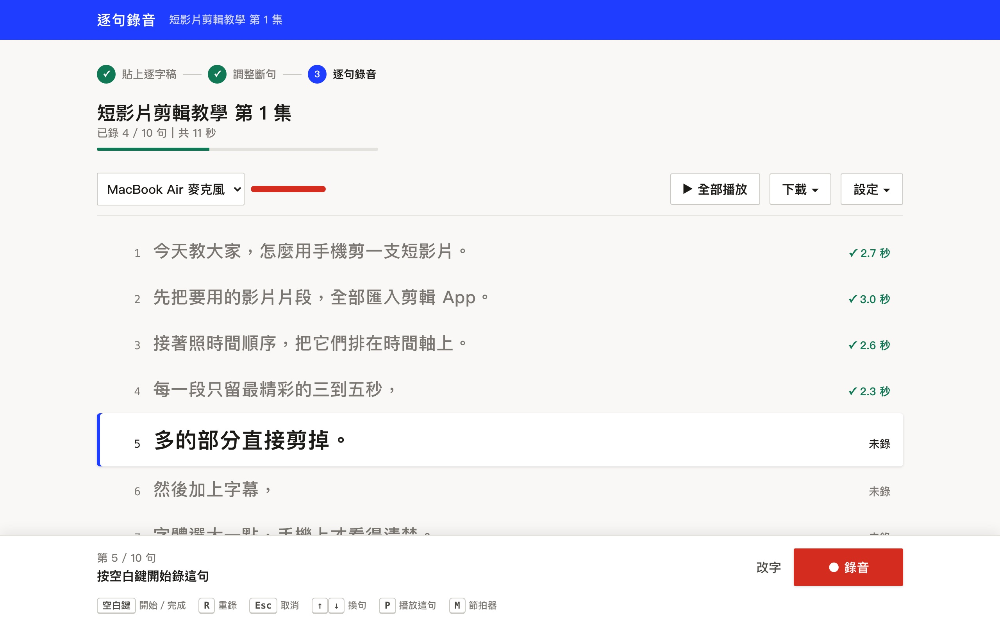

# 逐句錄音

貼上逐字稿，一句一句錄旁白。錄完自動接成一個音檔，字幕檔也一起做好。

給錄教學影片、短影音、Podcast、線上課程的人。



## 為什麼要一句一句錄

看著整段稿子唸，很容易唸錯、斷錯，一錯就整段重來。
改成一句一句錄：眼睛只要盯著一句，唸錯了只重錄那一句，錄完的句子自動排好、接好。

## 它能做什麼

- **自動斷句**：貼上逐字稿，照你選的長短切好。四種長短：
  | 模式 | 一段大約 | 適合 |
  |---|---|---|
  | 短句 | 15 字 | 一口氣一句，最不容易唸錯 |
  | 一般 | 25 字 | 一個完整句子 |
  | 長句 | 40 字 | 兩三句連著講，語氣比較連貫 |
  | 整段 | 照原稿段落 | 習慣一次講一大段 |
- **想怎麼斷就怎麼斷**：兩句合成一句、一句拆成兩句，一行就是一句，直接改
- **用 AI 斷句**：複製一段寫好的提示詞貼到自己的 ChatGPT 或 Claude，照換氣點斷得更自然（見下方）
- **錄音快捷鍵**：空白鍵開始／完成，R 重錄，Esc 取消，完成後自動跳下一句
- **全部播放**：從頭連著聽一遍，播到哪句亮哪句
- **下載**：合併成一個音檔（句子間留停頓、音量調到影片標準）、字幕檔 SRT、每句分開的 ZIP
- **開頭不收音**：按下錄音後可以設定等 0 到 1 秒才開始收音，按鍵聲、吸氣聲不會錄進去
- **句子間停頓**：合併音檔時句子之間停 0.2 到 0.8 秒，自己選
- **節拍器**：閃燈或聲音（聲音要戴耳機），幫你維持穩定的語速
- **錄音只存在你自己的電腦**，不會上傳到任何地方

## 安裝

需要：Python 3.9 以上（Mac 內建就有）、Chrome／Edge／Safari。
沒有其他套件要裝。想要「合併音檔自動調音量」，再另外裝 [ffmpeg](https://ffmpeg.org/)（沒裝也能用，只是合併檔是原始音量）。

### 方法一：交給 Claude Code（最簡單）

把這句話貼給 Claude Code：

```
幫我安裝這個工具，並把 skill 資料夾裡的技能裝好：https://github.com/raytioray/narration-recorder
```

裝好之後跟 Claude 說「把這份稿子丟進錄音工具」，它會幫你斷好句、直接建好，你打開網頁就能錄。

### 方法二：下載後雙擊

1. 按這頁上方綠色的 **Code → Download ZIP**，解壓縮
2. Mac：雙擊 `start.command`（第一次如果被擋，按右鍵 → 打開）
   Windows：雙擊 `start.bat`
3. 瀏覽器會自動打開 http://localhost:8780

### 方法三：指令

```
git clone https://github.com/raytioray/narration-recorder.git
cd narration-recorder
python3 server.py
```

## 怎麼用

1. **貼上逐字稿**：填影片名稱、貼稿子、選每次錄多長，按「下一步」
2. **調整斷句**：一行就是一句。兩句要一起講就刪掉中間的換行，一句要拆開就按 Enter
3. **逐句錄音**：第一次會問能不能用麥克風，按允許；上方選你的麥克風

| 按鍵 | 做什麼 |
|---|---|
| 空白鍵 | 開始錄／完成（完成會自動存檔、跳下一句） |
| R | 錄到一半重來 |
| Esc | 取消這次錄音 |
| ↑ ↓ | 換句 |
| P | 播放這句 |
| M | 節拍器開關 |
| Shift＋空白鍵 | 重錄已經錄好的句子（單按空白鍵不會蓋掉，避免手滑） |

錄到一半想改斷句：右上「設定 → 調整斷句」，字沒改到的句子錄音會保留。

「設定」裡還可以選：按下錄音後等幾秒才開始收音（0 到 1 秒）、合併音檔時句子之間停多久（0.2 到 0.8 秒）、字的大小、節拍器。

## 用 AI 斷句

**用自己的 ChatGPT 或 Claude**：在第一步按「用 AI 斷句」→ 複製提示詞（已經連同你的稿子準備好）→ 貼到 AI 送出 → 把結果貼回來。

**用 Claude Code**：照「方法一」裝好技能，直接說「把這份稿子丟進錄音工具」。也可以自己用指令送：

```
python3 push.py "影片名稱" 一行一句.txt --script 原稿.txt
```

## 錄音存在哪

工具資料夾裡的 `recordings/`，每份稿子一個資料夾：

```
recordings/
  20261021-1240_短影片剪輯教學/
    001.wav  002.wav ...   每句一個檔（48kHz 無損，頭尾的按鍵聲自動切掉）
    project.json           句子、檔名、秒數
    _刪除/                  刪掉或被重錄蓋掉的舊錄音，救得回來
```

想存到別的地方：啟動前設定環境變數 `NR_DATA=/你的/資料夾`。換連接埠用 `NR_PORT`。

## 安全

- 只在你自己的電腦上跑，只接受 `localhost` 開的網址，區網其他電腦連不進來
- 別的網站的網頁沒辦法偷偷操作這個工具（跨網站請求一律拒絕，寫入要帶專用標頭，也擋 DNS 綁架）
- 不會連到任何外部伺服器；「用 AI 斷句」只是幫你複製文字，要不要貼給 AI 由你決定
- 刪掉或被重錄蓋掉的錄音不會真的消失，都在 `_刪除/`

想從手機或別台電腦連（例如架在家裡的主機上），自己設 https 反向代理，並用 `NR_HOSTS=你的主機名稱` 把那個網址加進白名單。

## 常見問題

**按了錄音沒反應？** 網址要用 `localhost` 開（瀏覽器只允許 localhost 或 https 使用麥克風），並在網址列左邊確認麥克風權限是「允許」。

**音量太小？** 工具會提醒你。靠近麥克風一點，或在系統設定把麥克風輸入音量調高。下載「合併音檔」時會自動把音量調到影片標準（要裝 ffmpeg）。

**錄音會上傳嗎？** 不會。工具只在你自己的電腦上跑，錄音只存在 `recordings/`。

**可以拿錄好的音訓練 AI 聲音嗎？** 可以。每句錄音都對到一句文字，剛好是聲音複製工具要的格式（`project.json` 裡有對照）。

## 授權

MIT。歡迎修改、分享。

更多工具與教學：[raytio.com/resources](https://raytio.com/resources)
